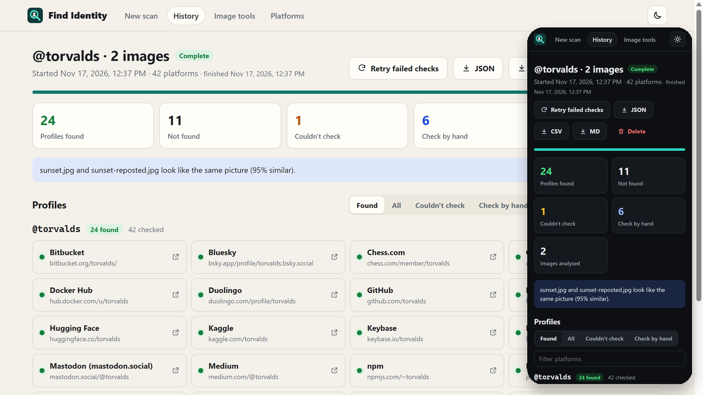
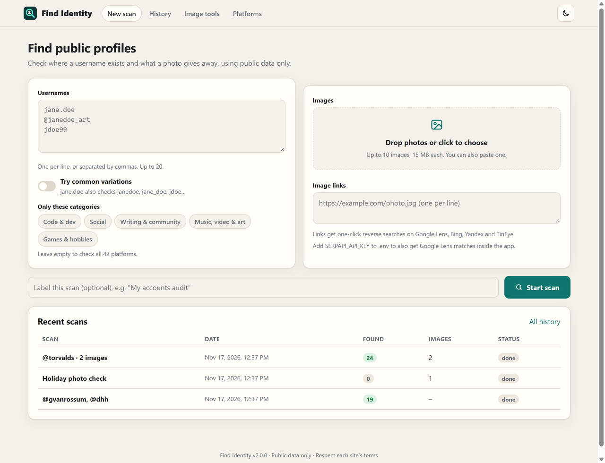
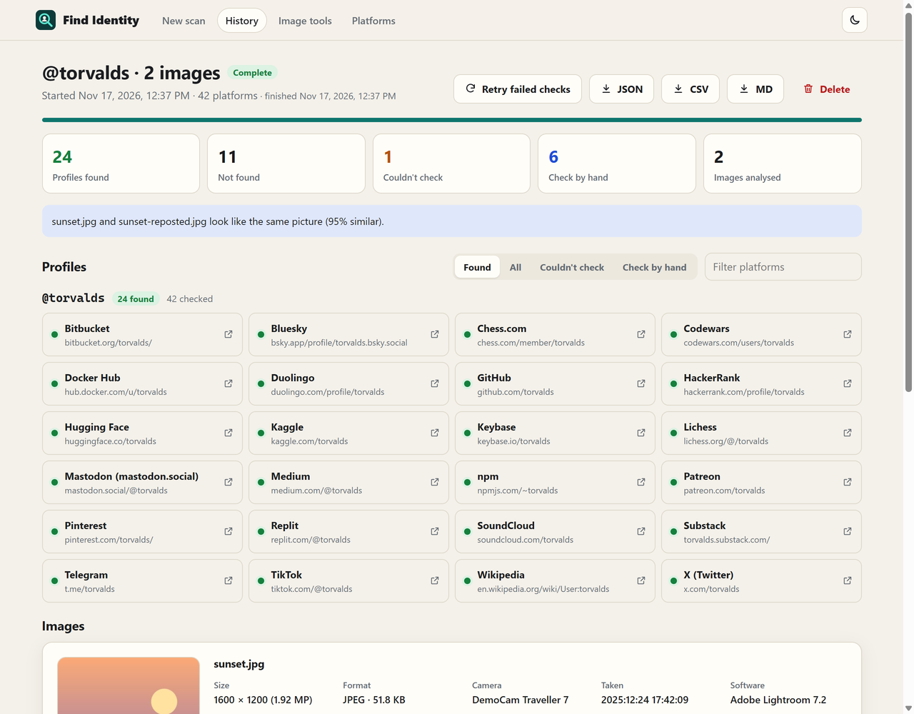
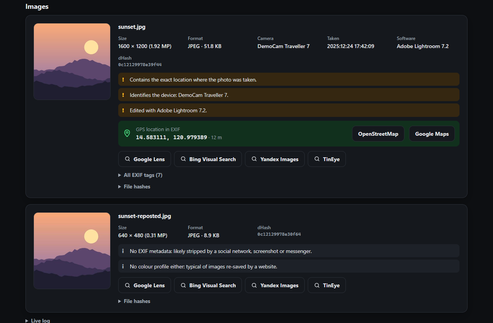
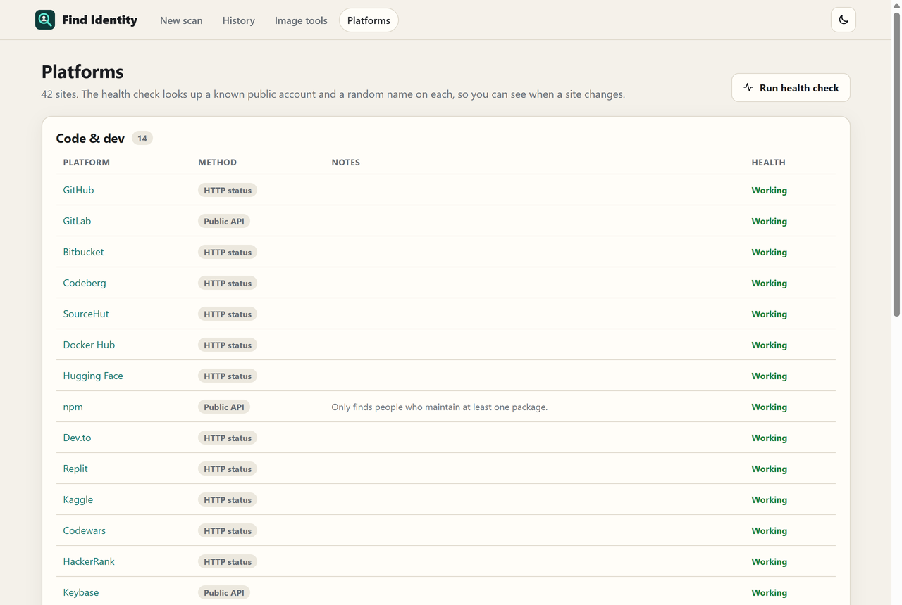
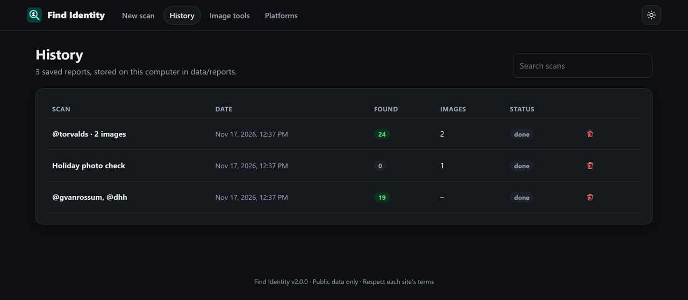
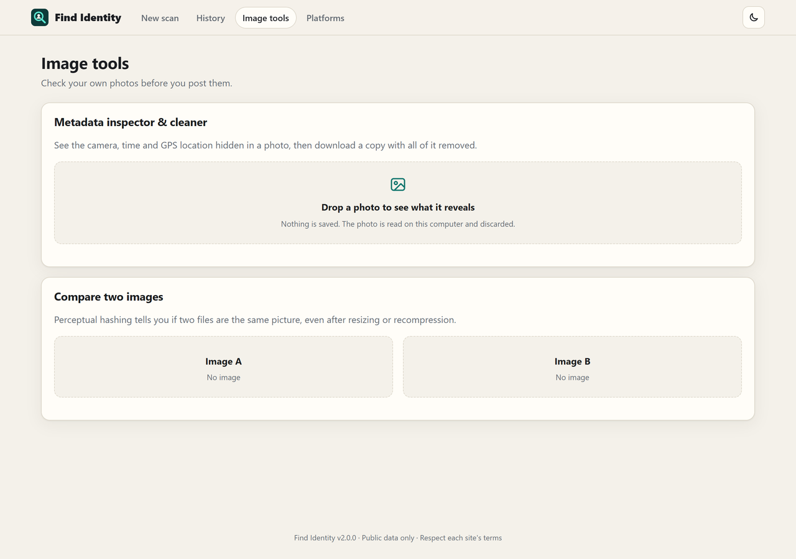

<div align="center">


# Find Identity

**See where a username exists and what a photo gives away. A local OSINT toolkit with a web app and a command line.**

[](#whats-new-in-20)
[](https://www.python.org/)
[](https://fastapi.tiangolo.com/)
[](#supported-platforms)
[](LICENSE)

[**Get started**](#get-started) · [Web app](#web-app) · [Command line](#command-line) · [Platforms](#supported-platforms)



</div>

## Why Find Identity

- **Answers you can trust.** Each site has its own rule for telling a real profile from a missing one. A blocked or rate-limited check shows as *Couldn't check*, never as *Not found*.
- **Photos, not just names.** Reads the camera, edit history and GPS location hidden in a photo, spots reposted copies of the same picture, and links straight into Google Lens, Bing, Yandex and TinEye.
- **Runs on your computer.** No account and no telemetry. Reports and thumbnails stay in `data/`. The only network requests go to the sites being checked and, if you add a key, SerpApi.

## Screenshots

<table>
  <tr>
    <td align="center"><br><sub><b>New scan</b><br>Usernames, variations, categories, photos</sub></td>
    <td align="center"><br><sub><b>Results</b><br>Live progress and every profile found</sub></td>
  </tr>
  <tr>
    <td align="center"><br><sub><b>Image forensics</b><br>EXIF, GPS, edits and reposted copies</sub></td>
    <td align="center"><br><sub><b>Platforms</b><br>Rule health check against live sites</sub></td>
  </tr>
  <tr>
    <td align="center"><br><sub><b>History</b><br>Every scan saved, searchable, exportable</sub></td>
    <td align="center"><br><sub><b>Image tools</b><br>Metadata cleaner and image compare</sub></td>
  </tr>
</table>

<sub>Screenshots show a scan of a well-known public developer handle and a fictional sample photo (`tools/make_demo_photo.py`).</sub>

## Features

| | |
|---|---|
| **Username search** | 42 platforms across code, social, writing, creative and gaming sites. Results stream in live. Each one is *Found*, *Not found*, *Couldn't check* (with the reason) or *Check by hand*. |
| **Variations** | `jane.doe` also tries `janedoe`, `jane_doe`, `jane-doe`, `jdoe`… Variations with no hits are hidden. |
| **Smart rules** | Public APIs where they exist, page markers where they don't, per-site username formats (a name with a dot is never "checked" on GitHub), and one automatic retry for network blips. |
| **Image forensics** | Size, format, camera, capture time (including the Exif sub-IFD), editing software, every readable EXIF tag, MD5/SHA-256 and a 64-bit perceptual hash. Plain-language warnings for anything that identifies you. |
| **GPS** | Coordinates and altitude from EXIF, with OpenStreetMap and Google Maps links. |
| **Reverse image search** | Images from a link open directly in Google Lens, Bing, Yandex and TinEye. With a SerpApi key, Google Lens matches (exact and visual) appear inside the report. |
| **Reposted copies** | Images in the same scan that are the same picture, even resized or recompressed, are flagged with a similarity score. |
| **Metadata cleaner** | Download a copy of any photo with EXIF, GPS and comments removed, upright and with its colour profile kept. |
| **Image compare** | Drop two files and get a similarity score from their perceptual hashes. |
| **History & exports** | Every scan is saved. Search, reopen, retry only the failed checks, or export as JSON, CSV or Markdown. |
| **Rule health check** | Looks up a known public account and a random name on every site, so you can see at a glance when a site changes. |
| **Safe by default** | Listens on `127.0.0.1` only. All values are escaped in the UI, with a strict Content-Security-Policy. Image links to private or local addresses are refused, and uploads are checked as real images before use. |

## Get started

Requirements: Python 3.10 or newer.

```bash
git clone https://github.com/Rohan-Reyes/find_identity.git
cd find_identity
python -m venv .venv
source .venv/bin/activate        # Windows: .venv\Scripts\activate
pip install -r requirements.txt
```

Optional: copy `.env.example` to `.env` and add a [SerpApi](https://serpapi.com) key to get Google Lens matches inside the app. Everything else works without it.

```env
SERPAPI_API_KEY=your_key
```

## Web app

```bash
python app.py --open             # http://127.0.0.1:8000
```

1. Type one or more usernames, and/or drop photos (or paste image links).
2. Press **Start scan**. Results appear as each site answers. You can leave the page and come back; the scan keeps running.
3. Open any found profile, export the report, or press **Retry failed checks** later.

Options: `--port 9000`, `--host 0.0.0.0` (the app has no login, so only do this on a network you trust).

## Command line

```bash
python main.py -u torvalds                                   # one username
python main.py -u jane.doe jdoe99 --variants --only code social
python main.py -u torvalds --all -o report.md                # every row, Markdown report
python main.py -f photo.jpg -i https://example.com/pic.jpg   # image forensics
python main.py --strip photo.jpg                              # writes photo-clean.jpg
python main.py --list-platforms
python main.py --check-rules                                  # rule health check
```

`-o` writes JSON, CSV or Markdown depending on the file extension.

<details>
<summary>All settings (<code>.env</code>)</summary>

| Variable | Default | |
|---|---|---|
| `SERPAPI_API_KEY` | – | Google Lens matches in reports |
| `FI_DATA_DIR` | `./data` | Where reports and thumbnails are stored |
| `FI_CONCURRENCY` | `8` | Requests in parallel |
| `FI_TIMEOUT` | `12` | Seconds per request |
| `FI_MAX_IMAGE_MB` | `15` | Largest image accepted |

</details>

## Supported platforms

| Category | Platforms |
|---|---|
| Code & dev | GitHub, GitLab, Bitbucket, Codeberg, SourceHut, Docker Hub, Hugging Face, npm, Dev.to, Replit, Kaggle, Codewars, HackerRank, Keybase |
| Social | Mastodon, Bluesky, X, Telegram, TikTok, Pinterest, YouTube · *by hand:* Reddit, Instagram, Threads, Facebook, LinkedIn |
| Writing & community | Medium, Substack, Hacker News, Wikipedia, Patreon, Duolingo |
| Music, video & art | SoundCloud, Vimeo, Dribbble, Flickr · *by hand:* Twitch |
| Games & hobbies | Steam, Lichess, Chess.com, itch.io, Monkeytype |

*By hand* means the site needs a logged-in browser or JavaScript to show a profile, so the report gives you the link to open instead of guessing.

Adding a site is one entry in [`findid/platforms.py`](findid/platforms.py): its profile URL, how to detect a missing user, and a known public account for the health check.

## What's new in 2.0

A rewrite of the whole app.

**New**
- New web UI: light and dark themes, works on phones, no CDN scripts. Pages: New scan, Results, History, Image tools and Platforms.
- 42 platforms (up from 11), grouped into categories you can filter.
- Username variations, saved history, *Retry failed checks*, and CSV and Markdown exports.
- Image links as input, with direct reverse-search links. Detects reposted copies across images.
- Metadata cleaner and image compare, in the app and in the CLI (`--strip`).
- Rule health check (`--check-rules` / Platforms page) and an automated test suite.

**Fixed**
- **False "not found" results.** Blocked, rate-limited and timed-out checks used to be reported as missing accounts. Hacker News now answers HTTP 419 to scripts, so every account showed as missing. Codeberg rejects old browser user-agents. Both now use their public APIs.
- **XSS in the dashboard.** Usernames, file names and search-result titles and links were inserted as HTML.
- **Crashes on non-images.** Uploading a non-image crashed the whole scan stream. Uploads are now validated, size-limited and stored under random names, and are no longer served publicly.
- **Lost capture dates.** The capture date and camera settings were never read, because they live in the Exif sub-IFD.
- **Broken `-i` / `--image-url`.** It tried to open the link as a local file and crashed. The CLI also required `-u` even for image-only runs.
- **Scans restarting on reconnect.** A dropped connection could restart a scan or show "Completed" when it wasn't. Scans now run in the background and the page resumes where it left off.
- **Oversized Google Lens uploads.** Large photos could still exceed SerpApi's 500 KB upload limit.
- **Unbounded memory.** Scan sessions were kept in memory forever.

## Tests

```bash
pip install -r requirements-dev.txt
pytest
```

The tests use mocked HTTP, so they don't touch the network. Run `python main.py --check-rules` to test the rules against the live sites.

## Project layout

```
app.py          Web server (FastAPI + Server-Sent Events)
main.py         Command line
findid/         Core package: platforms, recon, imaging, reverse search, jobs, reports
web/            Web UI (plain HTML, CSS and ES modules, no build step)
tests/          pytest suite
tools/          Demo photo generator
docs/images/    README images
```

## Responsible use

Find Identity only reads public pages and public APIs, the same things anyone can open in a browser. Use it to audit your own footprint, for security assessments you are authorised to run, and for research. Don't use it to track or harass people, and follow each site's terms of service and the privacy laws where you live.

## License

[MIT](LICENSE). Made by Rohan Reyes.
